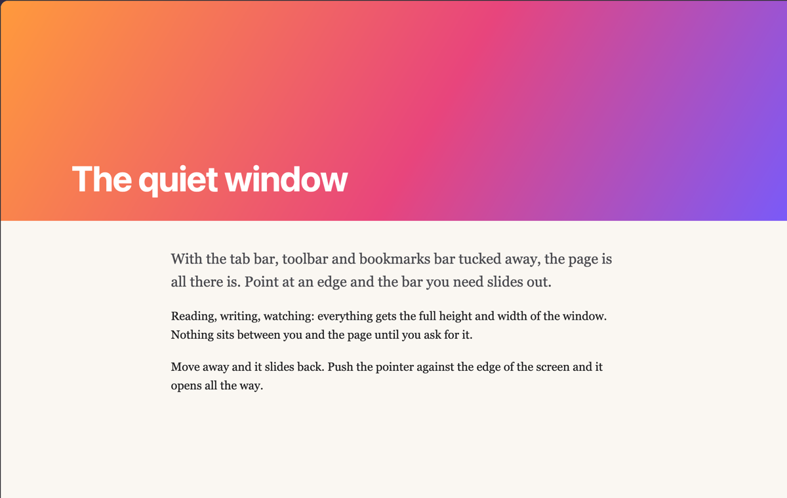
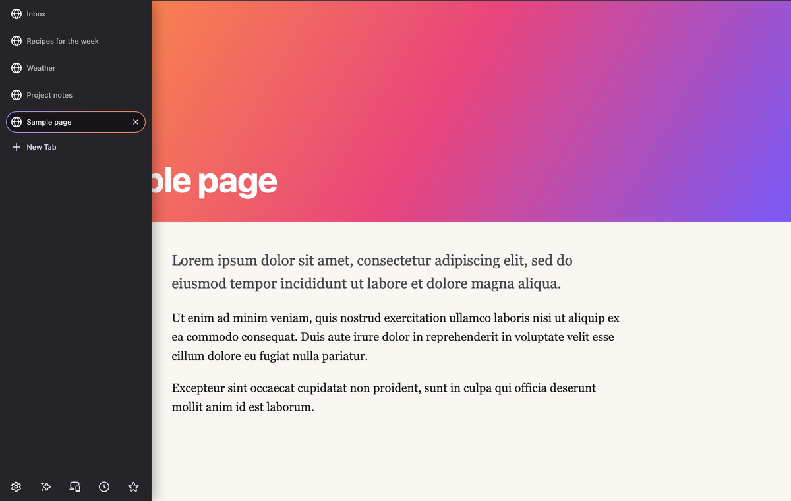
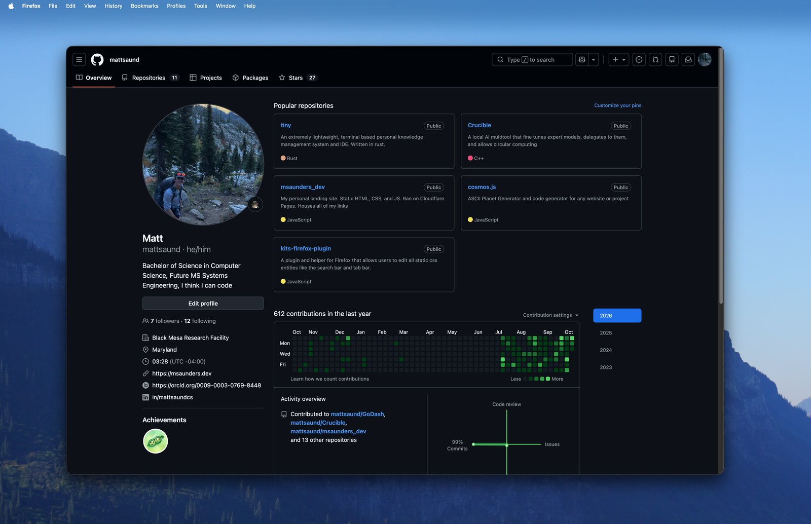
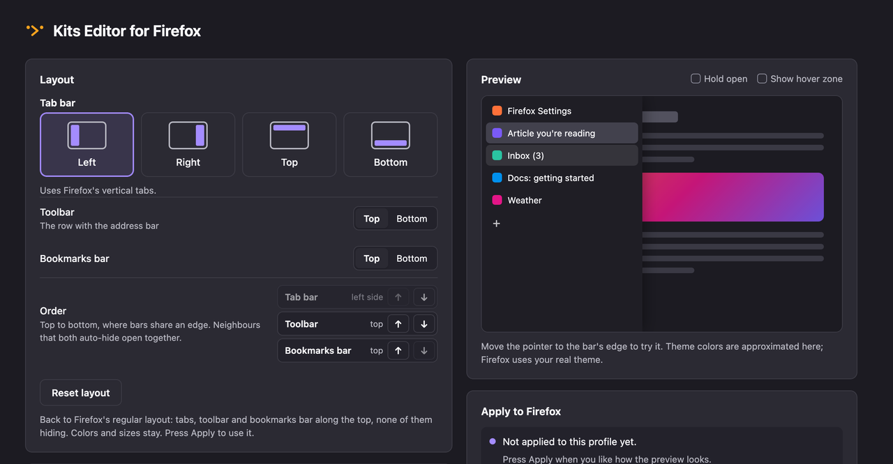

# Kits Editor for Firefox

Hide Firefox's bars until you need them. The page gets the whole window.

| Hidden | Point at the edge |
| --- | --- |
|  |  |

## What it does

- Tab bar on any edge. Toolbar and bookmarks bar on the top or bottom, in any
  order.
- Each bar can hide, and slides out when you point at its edge.
- Sizes, colors and speed, set inside Firefox with a live preview.
- Optional: links near an edge stay clickable.

## Infinite vertical space

With every bar hidden, the page runs from the top of the window to the bottom.

| Search | GitHub |
| --- | --- |
|  |  |

## Install

**1. Helper** (needs Python 3.8+)

macOS, Linux:

```sh
curl -fsSL https://github.com/mattsaund/kits-firefox-plugin/releases/latest/download/install.sh | sh
```

Windows (PowerShell):

```powershell
irm https://github.com/mattsaund/kits-firefox-plugin/releases/latest/download/install.ps1 | iex
```

**2. Extension.** Open the `.xpi` from the
[latest release](https://github.com/mattsaund/kits-firefox-plugin/releases/latest)
in Firefox.

**3. Set up.** Click the extension's toolbar button, pick a layout, press
**Apply**, restart Firefox.



When a new version is out, the extension tells you and **Download** installs
it. See the [changelog](CHANGELOG.md).

## Why a helper

Extensions can't restyle Firefox's own bars. Firefox reads that style from
`userChrome.css` in your profile, and the helper writes it there for you.

## Good to know

- **Apply** also changes a few Firefox settings the layout needs. The settings
  page lists them first.
- Your own `userChrome.css` edits are set aside, and come back when you remove.
- Only tab icons, no titles? Click Firefox's sidebar button once.
- Back to normal: **Reset layout**, then **Apply**.

## Privacy

Nothing is collected. Update checks are optional; they ask GitHub for the
latest version, so GitHub sees your IP address. **Let clicks through to the
page** only looks at what's under the pointer.

## Remove

Removing the extension turns its look off. To also remove its files, press
**Remove from Firefox** first, restart Firefox, then remove the helper:

```sh
curl -fsSL https://github.com/mattsaund/kits-firefox-plugin/releases/latest/download/install.sh | sh -s -- --uninstall
```

```powershell
& ([scriptblock]::Create((irm https://github.com/mattsaund/kits-firefox-plugin/releases/latest/download/install.ps1))) -Uninstall
```

## Contributing

**AI policy.** I am open to AI and agentic coding, but the code written needs
to follow specific guidelines:

1. MUST be human readable, acceptable variable/function names.
2. Easily traceable, following a good program flow.
3. Contributors MUST look at and document code and code changes. You need to
   understand the code that is being written.

**Tests.** `npm test` and `npm run lint`. A version is released by tagging it;
see `.github/workflows/release.yml`.

## License and credits

Created by Matthew Saunders (https://msaunders.dev) and Austin Laubach
(https://github.com/cli-geek).

MIT. See [LICENSE](LICENSE).
